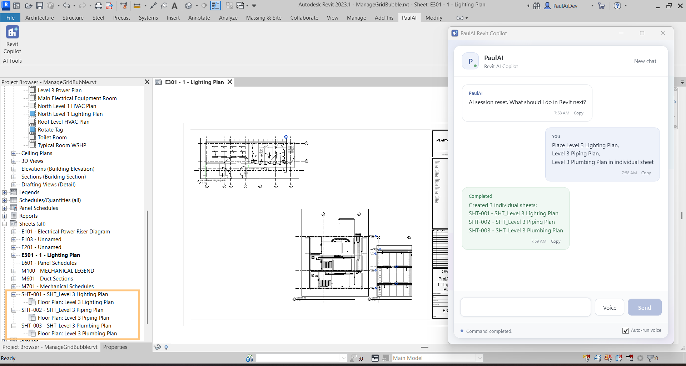
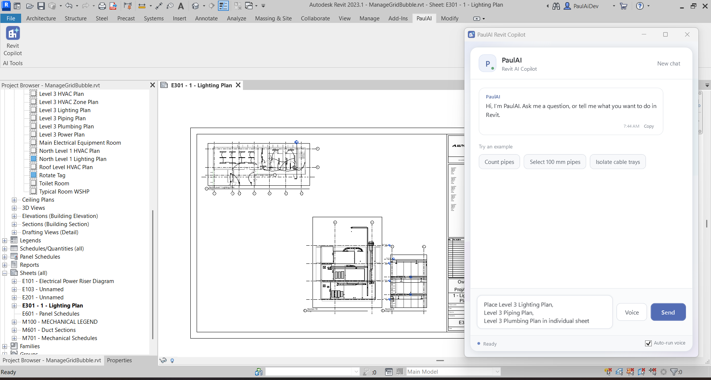
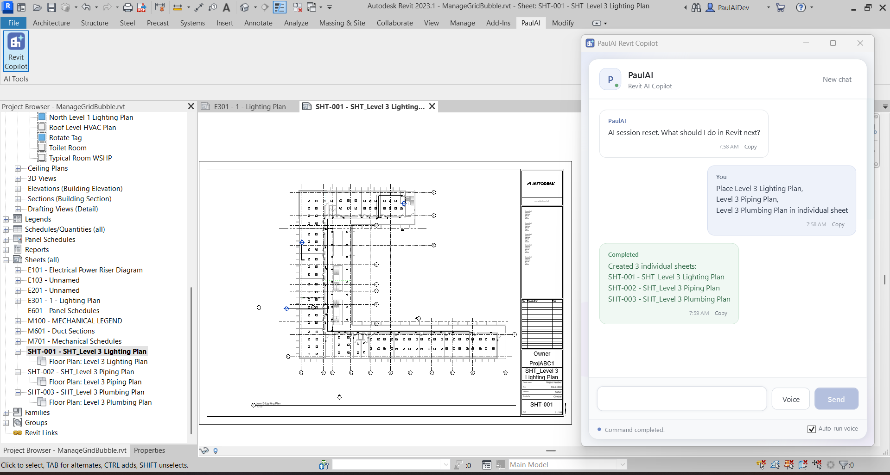

# PaulAI — Revit Copilot

AI-powered Revit automation showcase using C#, Revit API, WPF and a local LLM.

## Demo

### Before vs After — Revit Sheet Automation

This demonstration compares the traditional manual workflow with
PaulAI-assisted automation for:

- Creating 15 Revit sheets
- Placing named views on those sheets
- Exporting the resulting sheets as individual PDFs

**Manual workflow:** ~8 minutes  
**PaulAI workflow:** ~5 minutes

> The current prototype uses a locally hosted language model, so part of
> the execution time comes from local inference latency. The underlying
> Revit API automation is deterministic and can be paired with a faster
> inference backend in a production environment.

---

## Before

The manual process requires repeatedly creating sheets, naming them,
placing views, and exporting the resulting documentation.

---

## After — PaulAI

PaulAI interprets a natural-language request, converts it into a validated
structured command, and performs the corresponding Revit API operations.

---

## Automated Sheet Placement

The tool can create individual sheets for named views and place the
corresponding view on each sheet.

---

## Architecture

**Flow**

Natural Language  
→ Local LLM  
→ Structured Command  
→ Validation  
→ Revit ExternalEvent  
→ Dedicated Executor  
→ Revit API

---

## Key Capabilities

- Select / count / isolate supported MEP elements
- Parameter-based filtering
- Open and navigate Revit views
- Find placed / unplaced views
- Create sheets
- Place views on sheets
- Export sheets to PDF
- Close Revit view tabs
- Conversational clarification

---

## Technology

`C#` `Revit API` `.NET Framework 4.8` `WPF` `MVVM`
`Ollama` `Qwen2.5 7B` `JSON`

---

## Technical Overview

For architecture details, command flow, implementation boundaries and
current limitations:

[Read the Technical Overview](docs/TECHNICAL_OVERVIEW.md)

---

## Source Code

PaulAI is maintained as a private development project.

This repository is provided as a technical portfolio and demonstration of
the application's architecture and automation capabilities. The
implementation source code is not distributed through this repository.
