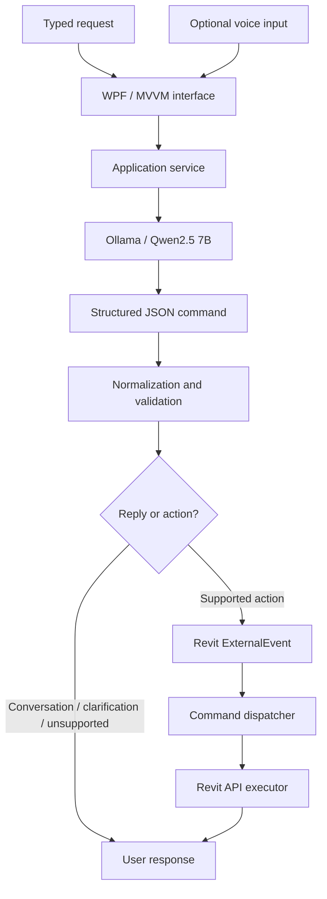

# PaulAI — Revit Copilot

**Technical Overview · Portfolio Edition · October 2026**

> This document accompanies the public PaulAI showcase repository.  
> The application source code is maintained privately; this document focuses on architecture, implemented capabilities, design decisions, and current scope.

---

## 1. Overview

**PaulAI / PaulAI Revit Copilot** is a Windows desktop assistant embedded in Autodesk Revit.

It allows users to submit natural-language requests through a modeless WPF interface. The request is interpreted by a local language model, converted into a structured command, validated, and then executed through controlled Revit API services.

PaulAI is designed as a **bounded BIM automation assistant**. It does not generate arbitrary C# code or execute unrestricted Revit API operations.

### Current focus

- MEP element selection, counting, and temporary isolation
- Parameter-based filtering
- Revit view navigation
- Sheet placement and management
- PDF export
- View-tab management
- Conversational clarification of incomplete commands

### Current technology baseline

- Autodesk Revit 2023
- C# 10
- .NET Framework 4.8
- WPF / MVVM
- Autodesk Revit API
- Ollama
- Qwen2.5 7B
- JSON-based structured commands

---

## 2. AI Command Interpretation

PaulAI uses **Qwen2.5 7B through Ollama** as its primary command interpreter.

The language model does not generate executable Revit code. Instead, it maps user language into a constrained structured command describing an allowed intent and its arguments.

Examples of information that may be extracted include:

- Intent
- Revit category
- View name and view type
- Sheet conditions
- Parameter filters
- Dimensions and units
- Requested operation

The application can also return conversational responses, clarification requests, or unsupported-operation messages when execution is not appropriate.

### Why a local language model?

The current implementation uses local inference because it:

- avoids requiring a hosted LLM API for command interpretation;
- gives tighter control over how Revit instructions are converted into structured data;
- keeps the command model separate from Revit execution;
- allows the application to validate commands before any model-changing action occurs.

PaulAI does **not** currently use custom model training, Revit-specific fine-tuning, a vector database, or a retrieval-augmented generation pipeline.

---

## 3. Application Architecture

PaulAI uses a layered Revit add-in architecture with WPF MVVM, structured commands, and a Revit `ExternalEvent` execution boundary.



### Layer responsibilities

| Layer | Responsibility |
|---|---|
| **UI / Presentation** | Modeless WPF interface, chat state, progress, optional voice controls |
| **Application** | Coordinates user requests, conversation context, command parsing, and results |
| **Domain** | Structured command contracts, filters, validation rules, and result models |
| **Infrastructure** | Local LLM integration and optional speech services |
| **Revit** | ExternalEvent bridge, collectors, filtering, transactions, navigation, sheet operations, and PDF export |

### Why `ExternalEvent` matters

Because PaulAI uses a modeless interface, Revit API operations cannot simply execute from arbitrary asynchronous UI code.

Supported actions are therefore routed through a Revit `ExternalEvent`, which returns execution to an appropriate Revit API context before interacting with the active document.

Transactions are used when the requested operation changes the model or document state.

---

## 4. Command Execution Flow

A typical request follows this path:

1. The user enters a natural-language instruction.
2. The application sends the request and relevant conversation context to the command parser.
3. The local LLM returns structured JSON.
4. The application normalizes and validates the command.
5. Unsupported or ambiguous requests are returned to the user without execution.
6. Valid executable commands are queued through the Revit `ExternalEvent` bridge.
7. A dedicated executor performs the supported Revit API operation.
8. The result is returned to the PaulAI interface.

This separation keeps **language interpretation** and **Revit execution** independent.

---

## 5. Current Capabilities

### 5.1 Select supported MEP elements

PaulAI can select supported MEP elements such as:

- Pipes
- Ducts
- Conduits
- Cable trays

Example requests:

```text
Select all pipes in the model.
Select conduits with diameter 25 mm.
```

---

### 5.2 Count supported MEP elements

Example requests:

```text
Count all ducts in the model.
How many pipes have diameter greater than 50 mm?
```

---

### 5.3 Temporarily isolate supported MEP elements

Example requests:

```text
Isolate pipes with diameter 50 mm.
Show only cable trays with width 300 mm.
```

Temporary isolation is applied in the active Revit view.

---

### 5.4 Parameter-based filtering

Selection, counting, and isolation support filters including:

- Diameter
- Width
- Height
- Rectangular size
- Level
- System type

Example requests:

```text
Select ducts with size 300 x 400 mm.
Count pipes on level Level 1.
Select pipes whose system type contains Heating.
```

Supported numeric filters include equality, inequality, greater-than, less-than, and inclusive comparisons.

---

### 5.5 Open named Revit views

PaulAI can navigate to named views across supported view types, including:

- Floor plans
- Ceiling plans
- Engineering plans
- Area plans
- Sections
- Details
- Elevations
- 3D views
- Drafting views
- Legends
- Schedules
- Sheets

Example:

```text
Open the floor plan "Typical Room WSHP".
Open section named Section A.
```

Ambiguous matches are reported rather than opening an arbitrary view.

---

### 5.6 Zoom to fit

Example:

```text
Zoom to fit.
Open floor plan Level 1 and zoom to fit.
```

---

### 5.7 Open the sheet containing a view

Example:

```text
Open the sheet containing the active view.
Open the sheet containing floor plan Level 1.
```

---

### 5.8 Check whether a view is placed on a sheet

Example:

```text
Is the view "Typical Room WSHP" placed on a sheet?
```

This is a read-only placement check.

---

### 5.9 List placed or unplaced views

Example:

```text
List floor plans that are not placed on any sheet.
List section views that are placed on sheets.
```

PaulAI returns matching view names and a count.

---

### 5.10 Create individual sheets and place views

Example:

```text
Place the views "XYZ", "ABC" on individual sheets.
Place views "XYZ", "ABC" on separate sheets with sheet name format ELEC_ViewName.
```

For supported requests PaulAI can:

- create one sheet per named view;
- generate unique sheet numbers;
- apply a supported sheet-name format;
- use an available title block;
- place the requested view on the sheet;
- perform the batch transactionally.

The current implementation centers the placed view. It is not intended to be an automated drawing-layout optimizer.

---

### 5.11 Delete sheets using sheet-number conditions

Example:

```text
Delete sheets whose sheet number contains SHT.
```

Matching sheets are presented to the user for confirmation before deletion.

---

### 5.12 Export sheets to PDF

Example:

```text
Print this sheet.
Export sheet number SHT001 to PDF.
Print all sheets where sheet number contains SHT.
```

For multiple sheets, the workflow can produce:

- one combined PDF; or
- individual PDF files.

The implementation includes filename sanitization, duplicate-name handling, validation of printable sheets, and partial-failure reporting.

In PaulAI, the word **Print** currently refers to PDF export rather than physical printer output.

---

### 5.13 Close other open Revit view tabs

Example:

```text
Close all views except view name "ABC".
Close all views except sheets whose number contains E301.
```

Only open tabs are closed; the underlying Revit views and sheets are not deleted.

---

### 5.14 Revit Undo

Example:

```text
Undo.
Undo the last operation.
```

PaulAI can request Revit's native Undo command when it is available.

---

### 5.15 Conversational clarification

PaulAI can retain bounded pending context when a request is incomplete.

Example:

```text
User: Open view "Typical Room WSHP".
PaulAI: Please specify the view type.
User: It is floor plan.
```

The clarification completes the pending request without requiring the user to restate the full instruction.

---

## 6. Optional Voice Interface

PaulAI also contains an experimental voice interaction layer.

Voice recognition converts speech to text and then sends the transcript through the same structured-command validation and Revit execution pipeline used by typed requests.

The core automation architecture does **not** depend on voice input; typed natural-language commands remain the primary demonstration path for this portfolio.

---

## 7. Safety and Execution Boundaries

PaulAI intentionally uses a constrained execution model.

Current boundaries include:

- no arbitrary generated scripts;
- no unrestricted Revit API execution;
- no autonomous creation of complete BIM designs;
- no general creation/editing of walls, families, or HVAC systems;
- no assumption that every natural-language variation will be understood;
- no automated optimized multi-view sheet layout;
- no autonomous multi-step planning agent.

Unsupported or invalid structured commands do not execute.

These boundaries are intentional: the language model interprets intent, while deterministic Revit API services remain responsible for document operations.

---

## 8. Current Scope and Limitations

PaulAI is a **proof-of-concept and personal R&D project**, not a finished commercial BIM product.

Current limitations include:

- commands are limited to explicitly implemented capabilities;
- document-specific naming and Revit constraints can affect execution;
- local LLM inference introduces machine-dependent latency;
- some workflows require confirmation dialogs;
- automatic title-block and drawing-layout optimization are not currently implemented;
- voice recognition can be less reliable for project-specific names than typed input;
- additional validation and edge-case handling would be required for production deployment at scale.

The project is being developed incrementally, with emphasis on controlled execution, extensible command handling, and practical Revit automation.

---

## 9. Technology Summary

| Area | Technology |
|---|---|
| Language | C# 10 |
| Framework | .NET Framework 4.8 |
| BIM Platform | Autodesk Revit 2023 |
| API | Autodesk Revit API |
| UI | WPF / MVVM |
| AI Runtime | Ollama |
| Language Model | Qwen2.5 7B |
| Command Exchange | Structured JSON |
| Revit Execution | ExternalEvent + dedicated executors |
| Optional Speech | Local / configurable speech services |

---

## 10. Project Status

PaulAI is maintained as a **private development project**.

This public repository is provided as a technical portfolio and demonstration of the application's:

- product concept;
- architecture;
- AI-assisted command pipeline;
- Revit API automation capabilities;
- before-and-after workflow improvements.

The implementation source code is intentionally not distributed through the public showcase repository.

---

## 11. Portfolio Demonstration Focus

For the public showcase, the recommended demonstration focuses on a practical Revit documentation workflow:

### Manual workflow

```text
Locate views
→ create sheets
→ place views
→ verify placement
→ export sheets to PDF
```

### PaulAI-assisted workflow

```text
Natural-language request
→ structured command
→ validation
→ Revit ExternalEvent
→ automated Revit API operations
→ completed documentation output
```

This demonstrates the central goal of PaulAI: **reducing repetitive Revit interaction while keeping execution controlled, explicit, and API-driven.**

---

**Project:** PaulAI — Revit Copilot  
**Developer:** Chayan Paul  
**Focus:** Revit API · BIM Automation · C#/.NET · AI for AEC
