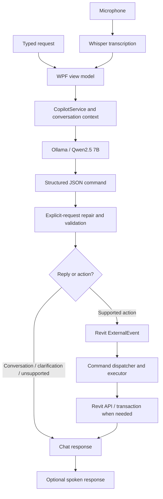

# PaulAI — Revit Copilot

**Technical overview and capability guide · Source review: 13 October 2026**

This guide describes the current source in this repository, including recent uncommitted changes. It is not a claim that every feature has been deployed or verified in a running Revit session. Examples are intended requests; names, numbers, and dimensions must match the user's project.

## 1. Tool name and short description

**Product name:** PaulAI / PaulAI Revit Copilot  
**Repository:** PaulAIRevitCopilot  
**Add-in assembly:** `RevitCoPilot.dll`

PaulAI is a Windows desktop assistant embedded in Autodesk Revit. Users type or speak requests in a modeless chat window. The assistant interprets the request, validates a structured command, and runs a supported operation through the Revit API.

Its current focus is MEP element selection/counting/isolation, view navigation, sheet placement and management, PDF export, and closing open view tabs. It is a bounded command assistant, not an autonomous BIM designer or an unrestricted code-execution agent.

The current project targets **Revit 2023, .NET Framework 4.8, C# 10, WPF, and x64**. Revit API references and deployment defaults point to Revit 2023. Other Revit versions have not been established as supported by this review.

## 2. AI models and speech providers

### 2.1 Main language model: Qwen2.5 7B through Ollama

The default command parser uses **`qwen2.5:7b`**, served by Ollama at `http://localhost:11434/`. It calls `/api/generate` with JSON output mode, temperature `0`, and streaming disabled. The command client has a **120-second timeout**.

The model converts language into a `RevitAiCommand`. That object identifies an allowed intent and its arguments, such as a view name, category, dimensions, or sheet-number condition. It can instead return `Conversation`, `Clarification`, or `Unsupported` with a user-facing reply.

The normal chat path uses this parser for **every submitted message**, including conversation and clarification replies. A separate `ConversationService` exists with its own Qwen configuration and built-in replies, but it is not the main `CopilotService.Process` execution route. Its existence should not be mistaken for a second model call on every command.

**Why this choice fits the implementation:** local inference avoids a hosted language-model dependency for command interpretation, works without a cloud LLM API key, and supports flexible language mapped to a constrained JSON schema. A 7B model offers more language capacity than a simple rule parser, with corresponding hardware and latency costs. These are engineering reasons consistent with the source; the repository does not contain a benchmark or a formal decision record proving why this exact model was originally selected.

There is no custom model training, Revit-specific fine-tuning, vector database, or retrieval-augmented generation pipeline in the current implementation. Domain behavior comes from instructions, examples, normalization, validation, and handwritten Revit executors. Temperature zero reduces sampling variation; it does not guarantee correct interpretation.

Source: [parser factory](RevitCoPilot/Application/Factories/CommandParserFactory.cs), [Ollama parser](RevitCoPilot/Infrastructure/Parsing/OllamaCommandParser.cs), [request contract](RevitCoPilot/Infrastructure/Parsing/OllamaGenerateRequest.cs).

### 2.2 Speech recognition: Whisper Small English

Microphone input uses **Whisper `small.en`**, through `Whisper.net`. The model file is `ggml-small.en.bin`, stored under `%LOCALAPPDATA%\PaulAIRevitCopilot\Models`. The code downloads it when missing, then transcribes locally with English language settings and a Revit-oriented recognition prompt.

Its job is audio-to-text, not deciding which Revit command to run. The resulting text enters the same command pipeline as typed input. The English-specific model fits the implemented English voice interface; no model-comparison evidence is recorded. Downloading the model initially requires connectivity.

Windows speech-recognition support also exists, including fallback/correction assistance in the speech pipeline. The default recognition wrapper constructs the Whisper service.

Source: [recognition provider](RevitCoPilot/Infrastructure/Speech/DefaultVoiceRecognitionService.cs), [Whisper implementation](RevitCoPilot/Infrastructure/Speech/WhisperVoiceRecognitionService.cs).

### 2.3 Speech output: Edge, optional OpenAI, and Windows fallback

| Provider | Current configuration | Purpose and reason |
|---|---|---|
| Default online voice | Edge neural speech, `en-US-AndrewMultilingualNeural` | Natural spoken replies using the `edge-tts` client; no API key is configured for this path. |
| Optional online voice | OpenAI `gpt-4o-mini-tts`, voice `marin`, PCM output | Streamed speech when `PAULAI_VOICE_PROVIDER=openai` and `OPENAI_API_KEY` are configured. This is speech synthesis, not the command LLM. |
| Local fallback | Windows `System.Speech` | Spoken output when the chosen online provider fails, or an explicitly selected OpenAI provider has no key. |

The default Edge path requires the Python `edge-tts` client. `PAULAI_EDGE_VOICE` overrides its voice. The implementation falls back to Windows speech after a neural-provider failure for that service instance.

**Privacy boundary:** the language-model and Whisper inference paths are local, but online speech synthesis sends the text being spoken to an external service. That text can include project names and results. The tool must therefore not be described as fully offline or as keeping all data local under every configuration. The existing operational README identifies the unofficial Edge client as a prototype/demo dependency.

Source: [voice-provider selection](RevitCoPilot/Infrastructure/Speech/DefaultVoiceSynthesisService.cs), [Edge output](RevitCoPilot/Infrastructure/Speech/EdgeNeuralVoiceSynthesisService.cs), [optional OpenAI output](RevitCoPilot/Infrastructure/Speech/OpenAiStreamingVoiceSynthesisService.cs).

## 3. Architecture used and why

The application uses a **layered Revit add-in architecture with WPF MVVM, structured commands, and a Revit ExternalEvent execution boundary**. It runs primarily inside the Revit process; Ollama is a separate local service. It is not a microservice system or a fully autonomous agent loop.



### 3.1 Layer responsibilities

| Layer / folder | Responsibility | Why it is useful |
|---|---|---|
| `App`, `Ribbon`, `Commands` | Register the add-in and ribbon; open or reactivate the modeless window. | Fits Revit's add-in lifecycle and gives users a familiar entry point. |
| `Presentation` | WPF views, view model, chat messages, progress, and voice controls. | MVVM separates interface state from command interpretation and execution. |
| `Application` | Coordinate requests, parser/provider interfaces, command descriptions, callbacks, and context. | Keeps the end-to-end workflow separate from individual API operations. |
| `Domain` | Command DTOs, filters, result objects, and selection/filename rules. | Provides explicit contracts and rules that can be tested without changing a Revit model. |
| `Infrastructure` | Ollama HTTP requests, language interpretation, speech recognition, and speech synthesis. | Contains dependencies on inference and audio providers. |
| `Revit` | External events, command dispatch, collectors, filters, units, and action executors. | Centralizes operations that depend on Autodesk APIs and the active document. |

This is practical separation within one project, not strict dependency isolation: services construct several concrete collaborators, and the application layer now references an explicit-request parser helper. There is no dependency-injection container.

### 3.2 How a request becomes an action

1. The window accepts typed text or a voice transcript.
2. `CopilotService` sends the current instruction, recent conversation, last successful structured command, and any pending clarification request to the parser.
3. Ollama returns JSON. The application does not ask it to generate executable C#.
4. `ExplicitViewRequest` repairs a narrow set of complete open/close requests after model interpretation. For example, an explicitly stated floor-plan type is retained even if the model asks for it again.
5. Normalization and validation check supported intents, categories, types, units, required names, and mutually exclusive conditions.
6. Non-execution replies appear in chat. Executable commands are queued through `RevitExternalEventService` and handled by `RevitExternalEventHandler`.
7. `RevitCommandExecutor` dispatches to a specific executor. Actual counts, matches, exports, and changes come from Revit.
8. The result updates chat and may be spoken. Temporary progress is shown separately from permanent message history.

The ExternalEvent bridge is essential to this modeless interface: asynchronous UI/model work must return to an appropriate Revit API context before operating on the document. Transactions are used for changes such as sheet placement, deletion, and temporary isolation. Navigation and tab closing are handled as UI operations.

Source: [chat coordinator](RevitCoPilot/Application/Services/CopilotService.cs), [external-event handler](RevitCoPilot/Revit/ExternalEvents/RevitExternalEventHandler.cs), [dispatcher](RevitCoPilot/Revit/Execution/RevitCommandExecutor.cs).

### 3.3 Clarification and failure behavior

Pending requests are distinct from the last successful command. For example, `It is floor plan` can supply the missing type for a pending open-view request. A new request replaces that pending context; unrelated conversation clears it. A bare acknowledgement should not repeat a completed operation.

These are bounded handling rules, not universal understanding of every typo or follow-up. Recent chat context is limited to eight messages with per-message truncation. No durable conversation database was found.

Unsupported or invalid structured commands do not execute. Model timeouts and connection failures return an error before any Revit operation. The explicit-request repair currently happens **after** the model call, so it does not remove inference latency or provide an offline command fast path.

## 4. Why this implementation does not use MCP

**MCP means Model Context Protocol. It is an integration protocol, not an AI model.** It provides a standard way for AI applications to discover and call tools and exchange context with servers. MCP servers can run locally or remotely; MCP does not inherently require cloud hosting. [Official MCP architecture overview](https://modelcontextprotocol.io/docs/learn/architecture)

The repository contains a custom command schema, a local Ollama HTTP client, and direct Revit executors. It does not implement an MCP client/server, MCP discovery, or MCP tool-call handlers. Using JSON alone does not make an application an MCP implementation.

There is no documented historical decision to reject MCP. The following explains why the current direct integration is a reasonable fit:

1. **One integrated host:** PaulAI's own Revit window is the current entry point; there is no present requirement for several external AI clients to discover its tools.
2. **Direct control of execution:** the add-in owns the active document, confirmation dialogs, validation, transactions, and ExternalEvent dispatch.
3. **Fewer integration components:** the current scope does not require an additional tool server, protocol lifecycle, or external session coordination.
4. **A fixed capability set:** handwritten intents and executors provide a controlled set of supported operations.

MCP would become useful if these Revit capabilities needed to be shared with multiple AI hosts, discovered dynamically, or composed with external tools. An MCP adapter could wrap the existing executors while retaining validation and the ExternalEvent bridge. It would not replace the Revit API, make unrestricted execution safe, or by itself make Qwen inference faster.

## 5. Current capabilities with examples

These features are implemented in source. Availability in a running installation depends on deploying the updated assembly, model interpretation, document state, and Revit's own restrictions.

### 1. Select supported MEP elements

Selects matching pipes, ducts, conduits, or cable trays using Revit element selection.

- `Select all pipes in the model.`
- `Select conduits with diameter 25 mm.`

The supported categories map to pipe curves, duct curves, conduit, and cable tray elements. This does not imply support for all MEP fittings, accessories, or equipment.

### 2. Count supported MEP elements

Returns the count after applying supported filters.

- `Count all ducts in the model.`
- `How many pipes have diameter greater than 50 mm?`

### 3. Temporarily isolate supported MEP elements

Applies temporary element isolation in the active Revit view.

- `Isolate pipes with diameter 50 mm.`
- `Show only cable trays with width 300 mm.`

The active view must support the operation; isolation does not create or delete those elements.

### 4. Filter MEP operations by parameters

Selection, counting, and isolation support diameter, size, width, height, level, and system type where those properties are available. Multiple filters are applied sequentially, effectively as AND conditions.

- `Select ducts with size 300 x 400 mm.`
- `Count pipes on level Level 1.`
- `Select pipes whose system type contains Heating.`

Numeric comparisons include equality, inequality, greater/less than, and inclusive comparisons. Text filters support equals, not-equals, and contains. Rectangular size pairs support equals/not-equals. Supported units include millimeters, inches, feet, and meters; unspecified numeric units default to millimeters.

**Current scope limitation:** `ElementCollectorService` collects from the entire active document and does not use `command.Scope` to restrict collection to the active view. Do not rely on an “in this view” request producing a view-only count or selection. Isolation acts in the active view, but its candidate collection is still document-wide.

### 5. Open a named view

Supports named navigation by view type, including floor plans, ceiling plans, engineering plans, area plans, sections, details, elevations, 3D, drafting views, legends, schedules, and sheets.

- `Open the floor plan "Typical Room WSHP".`
- `Open section named Section A.`
- `Open view ABC across all view types.`

Lookup excludes templates and tries exact, normalized, then partial names within the requested type scope. An ambiguous match reports candidates rather than arbitrarily opening one. A missing type normally requires clarification unless an all-types search was requested.

### 6. Zoom to fit

- `Zoom to fit.`
- `Open floor plan Level 1 and zoom to fit.`

Fits the active view, or opens and fits a named target when supplied and successfully interpreted.

### 7. Open the sheet containing a view

- `Open the sheet containing the active view.`
- `Open the sheet containing floor plan Level 1.`

The executor finds sheets containing the view. If multiple sheets contain it, it opens the first match and reports that there were multiple placements.

### 8. Check whether a named view is placed on a sheet

- `Is the view "Typical Room WSHP" placed on a sheet?`

This is a read-only placement check. It does not create a sheet or place the view. Missing or ambiguous names return an error instead of an incorrect “not placed” result.

### 9. List placed or unplaced views

- `List floor plans that are not placed on any sheet.`
- `List section views that are placed on sheets.`
- `Return the names of all views not placed on sheets.`

Returns sorted names and a count. Searches across view types when none is specified; templates and sheets themselves are excluded from the view-placement list.

### 10. Place named views on individual new sheets

- `Place the views "XYZ", "ABC" on individual sheets.`
- `Place views "XYZ", "ABC" on separate sheets with sheet name format ELEC_ViewName.`

Creates one new sheet for each named view. The default sheet-name format is `SHT_ViewName`; generated numbers are `SHT-001`, `SHT-002`, etc., skipping existing numbers. A custom name format must include `ViewName` or `{ViewName}`.

The active sheet's title block is preferred; otherwise the first loaded title-block type is used. Blank sheets are created when none is available. Placement is centered, not an automated drawing-layout optimizer. The batch is transactional; a failure rolls it back. Existing placed views are not moved automatically.

### 11. Delete sheets by text in sheet numbers

- `Delete sheets whose sheet number contains SHT.`

Uses literal, case-insensitive matching on sheet numbers. A Revit confirmation dialog shows matching sheets before deletion. Cancellation leaves them intact. Placed views are retained; sheet-owned contents are removed with the sheets. The batch rolls back on errors or unexpected dependent view/sheet deletion. A matching active sheet must be left before retrying.

This deletion feature does not support sheet-name matching, exact-number-only conditions, or arbitrary extra exclusions.

### 12. Print/export sheets to PDF

- `Print this sheet.`
- `Export sheet number SHT001 to PDF.`
- `Print all sheets where sheet number contains SHT.`
- `Print "A,B,C" sheets.`

The last example selects exact sheet names A, B, and C. Number matching is case-insensitive and preserves punctuation: `SHT001` and `SHT-001` differ.

For multiple sheets, a Revit dialog asks once whether to combine them:

- **Yes:** one combined PDF, with a chosen output filename.
- **No:** individual PDFs in a chosen folder, named after each sheet, such as `A.pdf` and `B.pdf`.

Invalid filename characters are sanitized and colliding generated names receive numeric suffixes. Existing individual output files cause the batch to stop before export. Missing/ambiguous named sheets or unprintable matches stop the request. If an individual export fails after others succeed, completed files remain and the result reports partial completion.

“Print” currently means PDF export, not physical-printer output. Unfiltered export of every sheet and non-PDF formats are not implemented.

### 13. Close other open view tabs

- `Close all views except view name "ABC".`
- `Close all views except sheets whose sheet name contains SHT.`
- `Close all the vies except the sheet E301.`
- `Close all views except sheets whose number contains E301.`

The exact view-name option keeps a uniquely matched open view. Sheet-name or sheet-number substring options keep all matching open sheets. `Sheet E301` means exact sheet number E301. The narrow repair step recognizes `vies` in this close-all phrasing.

Only tabs in the active document are closed; project views and sheets are not deleted. The kept target must already be open. A kept view is activated before other tabs close. No matches or an ambiguous exact view name leaves all tabs open. If Revit prevents a later close, the result reports partial completion.

### 14. Request Revit Undo

- `Undo.`
- `Undo the last operation.`

Posts Revit's native Undo command when available. It acts on Revit's undo stack, not a private PaulAI-only history; it may therefore undo the latest eligible Revit edit regardless of its origin. It cannot remove exported PDF files or reverse view-tab closing.

### 15. Use conversational clarification and follow-ups

- `Open view "Typical Room WSHP".` → when asked for its type: `It is floor plan.`
- After an incomplete close request: `Sheet number contain E301.`

Explicitly provided details are preserved by targeted repair, and pending context helps complete requests. General conversation and unsupported requests receive text responses instead of being executed as model changes.

### 16. Use voice input and spoken replies

The interface supports microphone recognition, a voice-assistant mode, transcript handling, and spoken responses. Recognized commands use the same validation/execution flow as typed commands. Voice introduces transcription uncertainty, particularly for project-specific names; typed prompts remain useful for exact spelling.

## 6. Performance and current limits

Every command still waits for local model inference. During a diagnostic check in this development session, `ollama ps` showed `qwen2.5:7b` loaded as **100% CPU**, approximately **5.1 GB**, with a **4096-token context**. This is a machine/session observation, not a required configuration or benchmark.

The reviewed system prompt is substantial, and conversation context adds more input. These can contribute to response time. The code does not currently collect Ollama's loading, prompt-evaluation, and generation timing metrics, so an exact latency breakdown is not established. Ollama documents both processor reporting and model residency controls in its [FAQ](https://docs.ollama.com/faq), and timing fields in its [usage documentation](https://docs.ollama.com/api/usage).

The discussed pre-model fast path, shorter task-specific prompts, GPU tuning, and longer model residency are **proposed improvements, not completed features**. Increasing a timeout would not itself speed up inference.

Other boundaries:

- No arbitrary generated scripts or unrestricted Revit API calls.
- No general creation/editing of walls, families, HVAC systems, or arbitrary parameters.
- No guaranteed understanding of every wording, typo, or multi-action request.
- No automated title-block selection or optimized multi-view sheet layout.
- No MCP integration, cloud command-model implementation, or autonomous multi-step planning loop.
- `ParserType.OpenAI` is declared but not implemented by the parser factory. Optional OpenAI speech output is a separate feature.
- A legacy rule parser exists but is not the default and does not have full feature parity; its PDF support is limited to active-sheet export.

## 7. Building, deployment, and verification

The project references the Revit 2023 API installation and includes NAudio, Newtonsoft.Json, System.Net.Http, Whisper.net, and Whisper.net.Runtime packages. The project file also contains a developer-specific default output path; use an explicit local build output when preparing a portable checkout.

Example local build from the repository root:

```powershell
dotnet build RevitCoPilot/RevitCoPilot.csproj -p:BaseOutputPath=bin/
```

Deployment scripts and application/external-command manifest templates are in `Deployment`. `Install-RevitAddin.ps1` supports selecting a manifest type and explicit assembly/manifest/bundle paths. Review those paths before installation. A successful build does not update an already loaded Revit assembly; install the intended output and restart Revit as appropriate.

The `Tests` folder contains PowerShell smoke checks and live Ollama checks. Smoke tests cover parser validation, name/number matching, filenames, structured follow-ups, and chat progress behavior. Live tests exercise interpretation through a running Ollama service; they do not perform the corresponding Revit actions.

Recent builds and the matching/routing/conversation regression tests passed during development, with existing nullable-annotation warnings. Live model checks have also encountered unavailable-service and timeout failures. In-Revit verification is still needed for actual sheet output, tab switching/closing, transactions, cancellation, and document-specific constraints. Do not equate parser-test success with complete end-to-end validation.

## 8. Source map for maintainers

| Area | Primary source |
|---|---|
| UI and voice interaction state | [CopilotViewModel](RevitCoPilot/Presentation/ViewModels/CopilotViewModel.cs) |
| Current request and pending context | [CopilotService](RevitCoPilot/Application/Services/CopilotService.cs) |
| Model instructions and command validation | [OllamaCommandParser](RevitCoPilot/Infrastructure/Parsing/OllamaCommandParser.cs) |
| Explicit view-request repair | [ExplicitViewRequest](RevitCoPilot/Infrastructure/Parsing/ExplicitViewRequest.cs) |
| Structured command fields | [RevitAiCommand](RevitCoPilot/Domain/Commands/RevitAICommands.cs) |
| API execution routing | [RevitCommandExecutor](RevitCoPilot/Revit/Execution/RevitCommandExecutor.cs) |
| View navigation and placement queries | [ViewCommandExecutor](RevitCoPilot/Revit/Execution/ViewCommandExecutor.cs) |
| New-sheet placement | [SheetPlacementExecutor](RevitCoPilot/Revit/Execution/SheetPlacementExecutor.cs) |
| Sheet deletion and confirmation | [SheetDeletionExecutor](RevitCoPilot/Revit/Execution/SheetDeletionExecutor.cs) |
| Combined/individual PDF output | [SheetPdfExecutor](RevitCoPilot/Revit/Execution/SheetPdfExecutor.cs) |
| Closing tabs | [CloseViewsExceptExecutor](RevitCoPilot/Revit/Execution/CloseViewsExceptExecutor.cs) |
| Element collection and scope limitation | [ElementCollectorService](RevitCoPilot/Revit/Collectors/ElementCollectorService.cs) |
| Parameter filtering | [ElementFilterService](RevitCoPilot/Revit/Filtering/ElementFilterService.cs) |

The shorter [operational README](README.md) retains feature-specific usage and test instructions. The loose `RevitAICommand.cs` at repository root is outside the main project directory; the active command contract used by the add-in is the domain file linked above.
